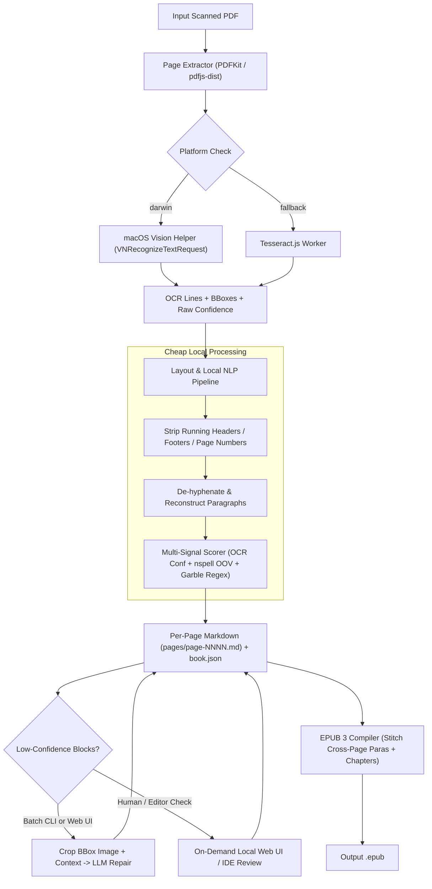

# Scanned PDF to EPUB Pipeline (`pdf2epub`)

Build a TypeScript CLI and on-demand local review web UI in `pdf2epub` that converts scanned PDF books into per-page Markdown files using native macOS Vision OCR (with cross-platform Tesseract fallback), scores text confidence via cheap local NLP heuristics, repairs only low-confidence regions with cropped-image LLM calls, and compiles the reviewed pages into an EPUB 3 book.

## Architecture Overview

The pipeline converts a scanned PDF into a workspace directory containing a manifest (`book.json`) and one Markdown file per page (`pages/page-0001.md`, `pages/page-0002.md`, ...), minimizing LLM usage through a 3-tier funnel:

1. **Tier 1 — Local OCR & Layout Extraction (Free)**: Uses a native macOS `Vision` + `PDFKit` Swift helper on macOS (the exact `VNRecognizeTextRequest` engine used by macOS Preview) with automatic fallback to `pdfjs-dist` + `tesseract.js` on non-macOS systems. Extracts line/block text, normalized bounding boxes, and engine confidence scores.
2. **Tier 2 — Local NLP & Heuristic Scorer (Free)**: Reconstructs paragraphs, strips repeating running headers/footers/page numbers, de-hyphenates line wraps, and computes a composite confidence score per paragraph block using OCR confidence, local Hunspell (`nspell`) + book-wide proper-noun frequency, and character-garble regex heuristics.
3. **Tier 3 — Targeted Cropped-Region LLM Fallback (Opt-in / Capped)**: Only blocks scoring below threshold are annotated in the page Markdown. When triggered (`fix-flagged` or Web UI), crops only the flagged bounding box from the PDF page image and sends that strip plus surrounding sentence context to an LLM.



## Workspace & Tooling Conventions

- Follow workspace standards from `miguelriosoliveira/shared-configs`:
  - Node `>=24.22.0` and `pnpm` in `package.json`.
  - Extend `@miguelriosoliveira/shared-configs/biome` in `biome.json` and `@miguelriosoliveira/shared-configs/tsconfig/node` in `tsconfig.json` with `noUncheckedIndexedAccess` and `exactOptionalPropertyTypes`.
  - Copy `.editorconfig`, `.nvmrc`, `.npmrc`, and `.lintstagedrc.json` from `shared-configs/copy-only/`.
  - Validate all external boundaries (OCR JSON output, `book.json`, Markdown frontmatter, LLM responses, CLI args) with `zod`.

## Directory Structure

- `package.json` — CLI entry (`bin: { "pdf2epub": "./dist/cli/index.js" }`), scripts (`dev`, `build`, `lint`, `typecheck`, `test`).
- `swift/vision-ocr.swift` — Self-contained Swift script compiled on first run to `.cache/bin/vision-ocr`. Uses `PDFKit` to render a page range at 300 DPI (or crop a normalized rect) and `Vision` (`VNRecognizeTextRequest` with `.accurate` recognition and `usesLanguageCorrection = true`) to emit JSON with lines, normalized bounding boxes, and confidence `[0..1]`.
- `src/types/domain.ts` — Zod schemas and discriminated unions for `OcrPageResult`, `TextBlock`, `ConfidenceBreakdown`, `PageFrontmatter`, and `BookManifest`.
- `src/ocr/`
  - `src/ocr/provider.ts` — Unified `OcrProvider` interface and platform auto-selector (`darwin` -> `VisionOcrProvider`, fallback -> `TesseractOcrProvider`).
  - `src/ocr/vision-provider.ts` — Compiles/invokes the Swift Vision helper and parses output via Zod.
  - `src/ocr/tesseract-provider.ts` — Renders PDF pages via `pdfjs-dist` + `@napi-rs/canvas` and runs `tesseract.js`.
- `src/nlp/`
  - `src/nlp/layout-reconstructor.ts` — Detects and strips repeating headers/footers/page numbers (top/bottom 8% y-band recurring across pages), detects chapter headings by bbox height and vertical whitespace, de-hyphenates end-of-line word splits, and detects cross-page paragraph continuations (`continuesFromPrev` / `continuesToNext`).
  - `src/nlp/confidence-scorer.ts` — Multi-signal local confidence scorer:
    - **OCR Confidence (45%)**: Length-weighted minimum/harmonic mean of line confidences in the block.
    - **Lexical Validity (30%)**: `nspell` dictionary lookup + book-wide token frequency index (so recurring proper nouns, character names, or technical terms in the book are not penalized as typos).
    - **Garble Heuristics (25%)**: Penalizes alphanumeric mixing (`t1me`, `rn` vs `m` anomalies), stray OCR symbols (`|`, `~`, `^`, unclosed brackets), impossible consonant runs, and broken hyphenations.
- `src/markdown/page-serializer.ts` — Reads and writes `pages/page-NNNN.md` with YAML frontmatter and inline block annotations for low-confidence paragraphs.
- `src/llm/repair.ts` — Extracts only flagged blocks, crops the exact bounding box (`bbox`) from the rendered PDF page image (with vertical margin), sends a minimal multimodal prompt (cropped image + noisy OCR text + 1 sentence before/after), and updates the block in `page-NNNN.md`.
- `src/epub/builder.ts` — Parses all `pages/page-NNNN.md` files, strips review annotations, joins paragraphs where `continuesToNext` / `continuesFromPrev` is true across page boundaries, splits into EPUB chapters at `# ` headings (or configured chapter ranges in `book.json`), and packages a valid EPUB 3 archive (`META-INF/container.xml`, `content.opf`, `nav.xhtml`, chapter `.xhtml` files, stylesheet).
- `src/web/server.ts` — Lightweight local HTTP server (`node:http` / Hono) serving a split-pane review page:
  - Left pane: Rendered PDF page image with highlighted SVG overlays for every low-confidence `bbox`.
  - Right pane: Markdown editor for `page-NNNN.md`, quick jump between flagged pages, "Mark Reviewed", and "Repair Block with LLM" button.
- `src/cli/index.ts` — CLI commands (`scan`, `status`, `fix-flagged`, `review`, `build`).

## Per-Page Markdown Format (`pages/page-0042.md`)

Each page is stored as an independent, human-editable file so you can compare page 42 of the PDF directly with `pages/page-0042.md`:

```markdown
---
page: 42
status: needs-review
confidence: 0.74
flaggedBlocks: 1
continuesFromPrev: true
continuesToNext: false
---

the rest of the sentence carried over from page 41, finishing the opening paragraph cleanly.

<!-- @flagged id="p42-b2" score="0.63" ocr="0.68" dict="0.55" reasons="oov:2,garble:1" bbox="0.11,0.34,0.78,0.12" -->
The mansc1pt was discovcred in the l1brary vault beneath the old cathedral.
<!-- /@flagged -->

Regular high-confidence paragraphs remain completely untouched without noisy markup.
```

## CLI Workflow Commands

- `pdf2epub scan <book.pdf> -o ./books/my-book [--pages 1-50] [--lang en] [--threshold 0.82] [--auto-llm --max-llm-blocks 20]`
  - Runs OCR + local NLP scoring, generates `book.json` and `pages/page-NNNN.md`, and prints a summary of clean vs. flagged pages and estimated LLM repair cost.
- `pdf2epub status ./books/my-book`
  - Lists all pages with `status: needs-review`, their lowest block confidence score, and reasons (`oov`, `ocr-conf`, `garble`).
- `pdf2epub fix-flagged ./books/my-book [--dry-run] [--page 42] [--max-blocks 25]`
  - Shows token/cost estimate on `--dry-run`, or crops flagged bounding boxes and repairs only those blocks via LLM, updating block status to `llm-fixed`.
- `pdf2epub review ./books/my-book [--port 4321]`
  - Starts the local side-by-side PDF page + Markdown inspector UI for quick visual spot-checks.
- `pdf2epub build ./books/my-book -o ./books/my-book.epub [--allow-unreviewed]`
  - Stitches cross-page paragraphs, splits into chapters by `# Heading` markers, and generates the `.epub` file.

## Implementation Checklist

- [x] `init-repo`: Initialize repository in `/Users/migrio/Projects/Personal/pdf2epub` with `pnpm`, `shared-configs` (Biome, tsconfig, copy-only dotfiles), and core dependencies (`zod`, `commander`, `nspell`, `gray-matter`, `archiver`/`jszip`).
- [x] `domain-schemas`: Define Zod domain schemas in `src/types/domain.ts` for OCR output, bounding boxes, confidence breakdown, page frontmatter, and `book.json` manifest.
- [x] `ocr-providers`: Build macOS Vision + PDFKit Swift helper (`swift/vision-ocr.swift`) and `VisionOcrProvider`, plus cross-platform `TesseractOcrProvider` fallback in `src/ocr/`.
- [x] `nlp-confidence`: Implement layout reconstruction (header/footer stripping, de-hyphenation, cross-page continuation detection) and multi-signal local NLP confidence scorer in `src/nlp/`.
- [x] `markdown-serializer`: Implement per-page Markdown serializer/parser (`pages/page-NNNN.md` with frontmatter and `@flagged` block comments) in `src/markdown/page-serializer.ts`.
- [x] `llm-repair`: Implement targeted cropped-bbox LLM repair service with dry-run cost estimator and max-block budget cap in `src/llm/repair.ts`.
- [x] `epub-builder`: Implement EPUB 3 compiler (cross-page paragraph stitching, chapter splitting, OPF/XHTML/TOC packaging) in `src/epub/builder.ts`.
- [x] `cli-and-webui`: Build CLI commands (`scan`, `status`, `fix-flagged`, `review`, `build`) in `src/cli/index.ts` and the on-demand local split-pane review web UI in `src/web/server.ts`.
- [x] `unit-tests`: Add unit tests for layout reconstruction, multi-signal confidence scoring, Markdown round-trip serialization, and EPUB cross-page stitching.
